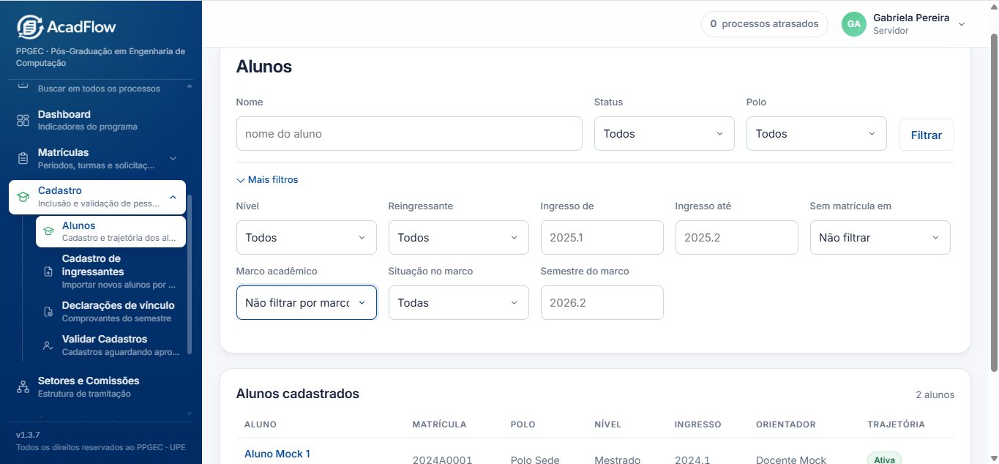
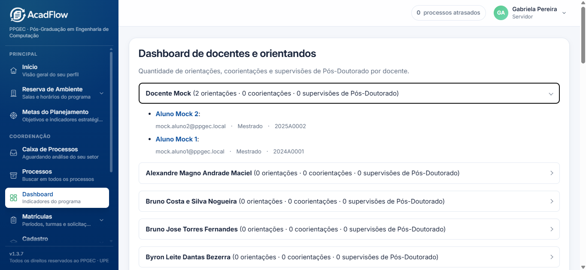

# Manual de Uso para a Secretaria: Módulo de Acompanhamento Acadêmico (AcadFlow)

Este manual tem como objetivo orientar a Secretaria do PPGEC no uso diário do **Módulo de Acompanhamento Acadêmico**. Ele detalha o fluxo de navegação, a aplicação de filtros e a interpretação de cada um dos painéis e recursos do sistema.

---

## 1. Acesso ao Módulo e Página Inicial (Início)

### **Como Navegar**
1. Na barra lateral esquerda do **AcadFlow**, localize o grupo **Coordenação**.
2. Clique no item **Acompanhamento (Prazos e indicadores dos alunos)**.
3. Você será direcionado para a central de navegação que reúne os links para todas as telas do módulo:
   * **Painel de Docentes**
   * **Painel de Processos**
   * **Carga de orientação**
   * **Calendário de Marcos**
   * **Painel de sucesso por turma**

### **Cartão "Alunos Irregulares" na Página Inicial**
Para os usuários que possuem acesso de gestão (como Coordenação, Secretaria, Servidores e Bolsistas), a página inicial do sistema (**Início**) apresenta o cartão **"Alunos irregulares"**, que **é o primeiro cartão da Visão geral**.
* **O que exibe:** O quantitativo total consolidado de discentes que possuem pelo menos uma irregularidade ativa em qualquer um dos marcos acadêmicos.
* **Integração:** Ao clicar sobre o cartão, você será direcionado automaticamente para a **Lista de Alunos**, já pré-filtrada com a situação **"Irregular"** no modo **"Qualquer marco"**.

---

## 2. Lista de Alunos e Acompanhamento de Prazos

### **Como Navegar e Filtrar**
1. Na barra lateral, acesse **Cadastro > Alunos** (ou pelo caminho de navegação do sistema).
2. Utilize os filtros no topo da tela para monitorar a situação dos discentes:
   * **Marco acadêmico:** Escolha entre **"Projeto de dissertação ou qualificação"**, **"Defesa"** ou **"Qualquer marco"**. A opção **"Qualquer marco"** exibe uma linha por aluno que esteja irregular em um ou nos dois marcos; utilize-a obrigatoriamente combinada com a situação **"Irregular"** e mantendo o campo de semestre em branco.
   * **Situação no marco:** Selecione o status do discente entre as três opções disponíveis:
     * **Irregular:** Une e agrupa todas as situações de atraso no marco.
     * **Regular:** A situação está em dia ou o marco já foi cumprido.
     * **Não foi possível calcular:** Falta um dado para o cálculo, como a data limite do semestre.
   > **Dica de Uso:** Para identificar rapidamente discentes em atraso, a secretaria deve selecionar a opção **"Irregular"**.
   * **Semestre do marco:** Digite o período referente (ex: `2026.1`).

### **Exportação para Excel**
Após selecionar um **Marco acadêmico**, o botão **Baixar em Excel** ficará visível na tela. Clique nele para gerar e baixar a planilha.
* A planilha gerada em Excel traz exatamente os discentes resultantes dos filtros aplicados na tela.
* O arquivo inclui **no topo da planilha** a indicação clara dos **filtros aplicados**, o **total de alunos listados** e a **data e hora exatas** em que a exportação foi gerada.

---

## 3. Painel de Docentes

### **Como Navegar e Filtrar**
1. Acesse o **Painel de Docentes** pela central de **Acompanhamento**.
2. No canto superior direito da tela, utilize o botão **"Só permanentes"** para alternar a exibição apenas entre professores do corpo permanente ou visualizar o total geral (permanentes e colaboradores).

### **Como Interpretar os Dados**
* **Cards Superiores:** Exibem o quantitativo total de docentes ativos, a divisão entre permanentes e colaboradores (com suas respectivas porcentagens), além da classificação entre docentes internos e externos à UPE.
* **Distribuição por Polo:** Exibe graficamente o percentual e a quantidade de professores em cada polo do programa.

---

## 4. Carga de Orientação

### **Como Navegar e Interpretar**
1. Acesse **Carga de orientação** através da página inicial do módulo de Acompanhamento.
2. O painel apresenta o quantitativo de orientações, coorientações e supervisões de pós-doutorado vinculadas a cada docente do programa, permitindo o acompanhamento da distribuição de discentes entre o corpo docente.

---

## 5. Painel de Processos

### **Como Navegar e Filtrar**
1. Clique em **Painel de Processos** na central de Acompanhamento.
2. **Filtragem por Semestre ou Período:**
   * **Por Semestre:** Selecione o semestre desejado na caixa de seleção **Semestre** (ex: `2026.2`) e clique em **Filtrar**.
   * **Por Intervalo Customizado:** Preencha os campos **Data inicial** e **Data final** (no formato `DD/MM/AAAA`) e clique em **Filtrar**.
   > **Nota:** Se as duas datas forem informadas, o intervalo personalizado prevalece sobre a seleção do semestre.

### **Como Interpretar os Dados**
* **Resumo Superior:** Mostra a contagem de **Processos abertos**, **Em atraso** e o **Tempo médio (em dias) até a finalização** (exibindo "Sem dados" quando nenhum processo foi concluído no período).
* **Por Tipo:** Gráfico de barras indicando a quantidade de processos por categoria.
* **Por Tipo e Mês:** Detalhamento cronológico da entrada dos processos por mês e tipo.
* **Por Status:** Distribuição dos requerimentos conforme a fase de tramitação atual (ex: *Em análise*, *Aguardando documento*).
* **Abertos por mês:** Visualização em barras com o total de processos abertos em cada mês do período selecionado.

---

## 6. Calendário de Marcos

### **Como Navegar e Cadastrar**
1. Selecione **Calendário de Marcos** no menu de Acompanhamento.
2. Para cadastrar um novo marco de acompanhamento do programa:
   * **Tipo:** Selecione o evento no menu suspenso.
   * **Semestre:** Digite o semestre no formato `YYYY.1` ou `YYYY.2`.
   * **Data limite:** Informe a data máxima para cumprimento da atividade pelo discente.
   * Clique no botão **Salvar**.

### **Como Interpretar**
* A tabela inferior consolida os marcos cadastrados, indicando o semestre e a data limite de cumprimento. Discentes que não apresentarem até a data cadastrada serão contabilizados como reprovados pela rotina automatizada do sistema.

---

## 7. Painel de Sucesso por Turma

### **Como Navegar e Filtrar**
1. Clique em **Painel de sucesso por turma** na central de Acompanhamento.
2. Utilize o formulário superior para definir os filtros de consulta:
   * **Nível:** Selecione entre **Mestrado** ou **Doutorado**.
   * **Ano inicial e Ano final:** Informe o intervalo de anos desejado (ex.: ano inicial `2024` e ano final `2026`) para filtrar as turmas pelo ano de ingresso. Deixar estes campos em branco significa consultar todas as turmas cadastradas.
3. Clique em **Filtrar**. Os valores informados permanecem selecionados no formulário após a submissão.

### **Como Ler o Gráfico das Sete Barras**
A tela exibe um **gráfico comparativo único**, onde cada turma de ingresso é representada por um grupo de 7 colunas verticais dispostas lado a lado, ordenadas cronologicamente da turma mais antiga para a mais nova.

As 7 categorias exibidas por turma são:
1. **Concluídos**
2. **Desligados**
3. **Trancados**
4. **Ativos** (Soma total dos discentes com vínculo ativo)
5. **Ativos regulares**
6. **Ativos irregulares**
7. **Com prorrogação**

#### **Regras de Interpretação e Cálculo:**
* **Altura da Barra:** A altura visual de cada coluna representa o percentual exato calculated em relação ao total de ingressantes daquela turma específica.
* **Quantidade Absoluta:** O número posicionado acima de cada barra indica a quantidade absoluta de alunos naquela condição. **Ao passar o mouse sobre a barra, aparecem** o rótulo completo, a quantidade e o percentual formatado.
* **Ativos Regulares:** A categoria **Ativos regulares inclui quem aparece como "Não foi possível calcular" na lista de alunos**.
* **Turmas Históricas (marcadas com \*):** Turmas anteriores a `2026.2` são sinalizadas com um asterisco ao lado do nome da turma (ex.: `2025.1*`). Um aviso destacado comunica que registros de desligamentos, prorrogações ou defesas anteriores à implantação do AcadFlow podem não estar totalmente cadastrados.
* **Turmas Recentes:** Turmas mais recentes podem apresentar 0% na coluna de *Concluídos*, uma vez que o regulamento exige um tempo mínimo para a realização de defesas (12 meses para o Mestrado e 24 meses para o Doutorado).
* **Regra da Categoria "Com Prorrogação":** A barra **"Com prorrogação"** contabiliza qualquer discente da turma que tenha recebido concessão de prazo extra ao longo de sua trajetória, independentemente de seu status atual (seja ele ativo, concluído, trancado ou desligado).
