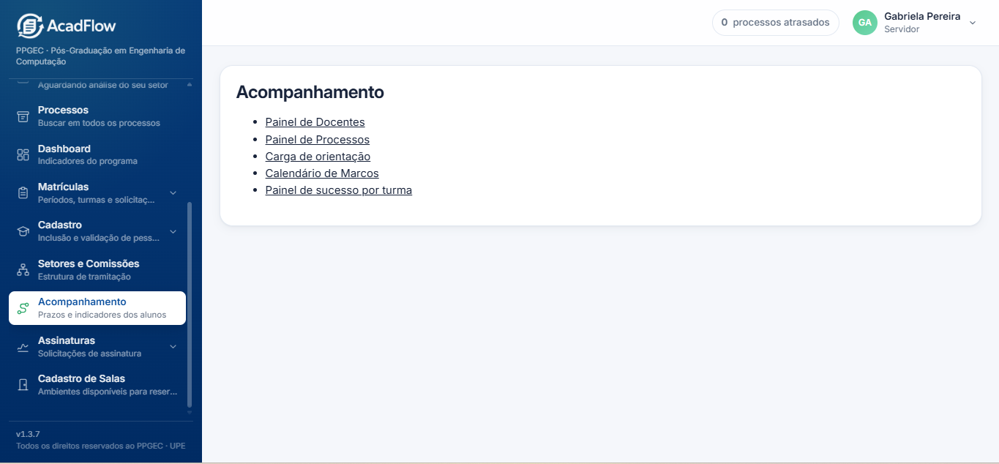
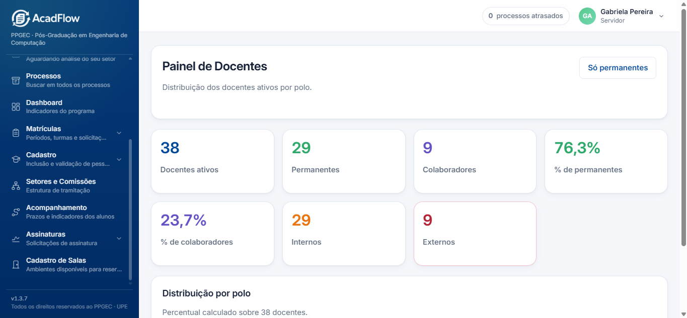
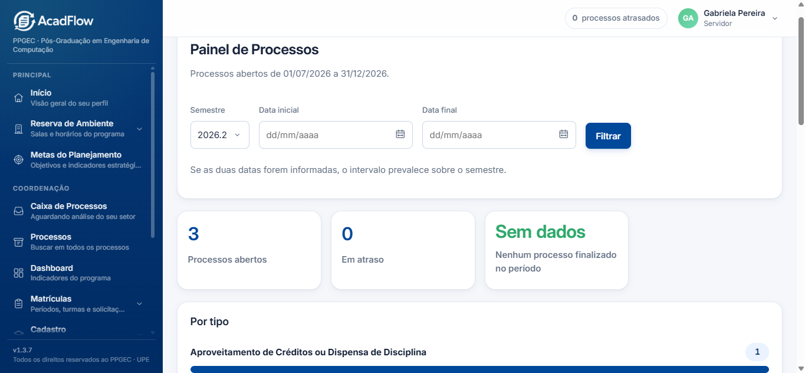
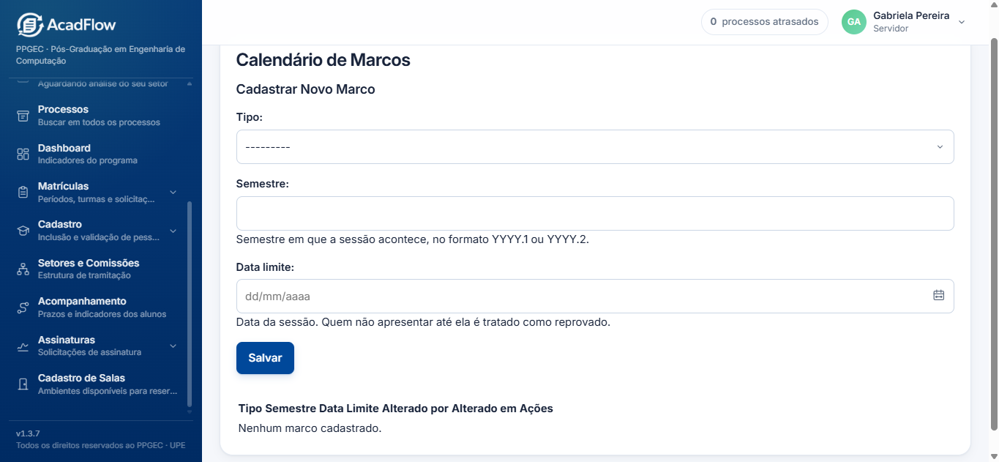
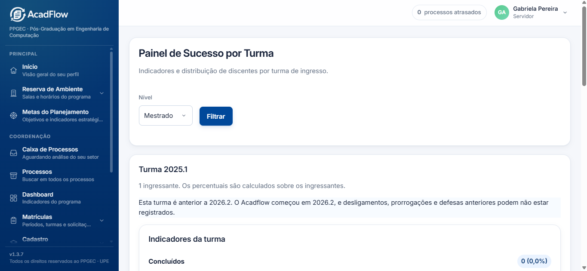

# Manual de Uso para a Secretaria: Módulo de Acompanhamento Acadêmico (AcadFlow)

Este manual tem como objetivo orientar a Secretaria do PPGEC no uso diário do **Módulo de Acompanhamento Acadêmico**. Ele detalha o fluxo de navegação, a aplicação de filtros e a interpretação de cada um dos painéis do sistema.

---

## 1. Acesso ao Módulo de Acompanhamento

### **Como Navegar**
1. Na barra lateral esquerda do **AcadFlow**, localize o grupo **Coordenação**.
2. Clique no item **Acompanhamento (Prazos e indicadores dos alunos)**.
3. Você será direcionado para a central de navegação que reúne os links para todas as telas do módulo.

---

## 2. Painel de Docentes e Orientandos

### **Como Navegar e Filtrar**
1. Acesse o **Painel de Docentes** pela central de **Acompanhamento**.
2. No canto superior direito da tela, utilize o botão **"Só permanentes"** para alternar a exibição apenas entre professores do corpo permanente ou visualizar o total geral (permanentes e colaboradores).

### **Como Interpretar os Dados**
* **Cards Superiores:** Exibem o quantitativo total de docentes ativos, a divisão entre permanentes e colaboradores (com suas respectivas porcentagens), além da classificação entre docentes internos e externos à UPE.
* **Distribuição por Polo:** Exibe graficamente o percentual e a quantidade de professores em cada polo do programa.
* **Listagem de Orientandos:** Ao clicar sobre o card de um professor, a lista se expande revelando os alunos vinculados, o nível de pós-graduação (Mestrado/Doutorado) e o número de matrícula.

---

## 3. Painel de Processos

### **Como Navegar e Filtrar**
1. Clique em **Painel de Processos** na central de Acompanhamento.
2. **Filtragem por Semestre ou Período:**
   * **Por Semestre:** Selecione o semestre desejado na caixa de seleção **Semestre** (ex: `2026.2`) e clique em **Filtrar**.
   * **Por Intervalo Customizado:** Preencha os campos **Data inicial** e **Data final** (no formato `DD/MM/AAAA`) e clique em **Filtrar**.
   > **Nota:** Se as duas datas forem informadas, o intervalo personalizado prevalece sobre a seleção do semestre.

### **Como Interpretar os Dados**
* **Resumo Superior:** Mostra a contagem de **Processos abertos**, **Em atraso** e **Finalizados no período**.
* **Por Tipo:** Gráfico de barras indicando a quantidade de processos por categoria (ex: *Aproveitamento de Créditos ou Dispensa de Disciplina*, *Prorrogação de Prazo*, etc.).
* **Por Tipo e Mês:** Detalhamento cronológico da entrada dos processos por mês e tipo.
* **Por Status:** Distribuição dos requerimentos conforme a fase de tramitação atual (ex: *Em análise*, *Aguardando documento*).

---

## 4. Calendário de Marcos

### **Como Navegar e Cadastrar**
1. Selecione **Calendário de Marcos** no menu de Acompanhamento.
2. Para cadastrar um novo marco de acompanhamento do programa:
   * **Tipo:** Selecione o evento no menu suspenso.
   * **Semestre:** Digite o semestre no formato `YYYY.1` ou `YYYY.2`.
   * **Data limite:** Informe a data máxima para cumprimento da atividade pelo discente.
   * Clique no botão **Salvar**.

### **Como Interpretar**
* A tabela inferior consolida os marcos cadastrados, indicando o semestre e a data limite de cumprimento. Discentes que não apresentarem até a data cadastrada serão contabilizados como reprovados pela rotina automatizada do sistema.

---

## 5. Painel de Sucesso por Turma

### **Como Navegar e Filtrar**
1. Clique em **Painel de sucesso por turma**.
2. No campo **Nível**, selecione entre **Mestrado** ou **Doutorado** e clique em **Filtrar**.

### **Como Interpretar os Dados**
* **Aviso de Dados Limitados:** Em turmas anteriores a `2026.2`, um alerta informativo é exibido comunicando que registros históricos de desligamentos, prorrogações ou defesas anteriores ao início do uso do AcadFlow podem não estar cadastrados.
* **Total de Ingressantes:** Apresenta o número absoluto de alunos cadastrados naquela turma de ingresso.
* **Indicadores em Barras (Proporcionais):**
  * **Concluídos, Desligados, Trancados e Ativos:** A largura de cada barra representa o percentual exato calculated em relação ao total de ingressantes da turma.
  * **Ativos Regulares, Ativos Irregulares e Com Prorrogação:** Acompanhamento detalhado do status atual dos alunos que permanecem matriculados no programa.